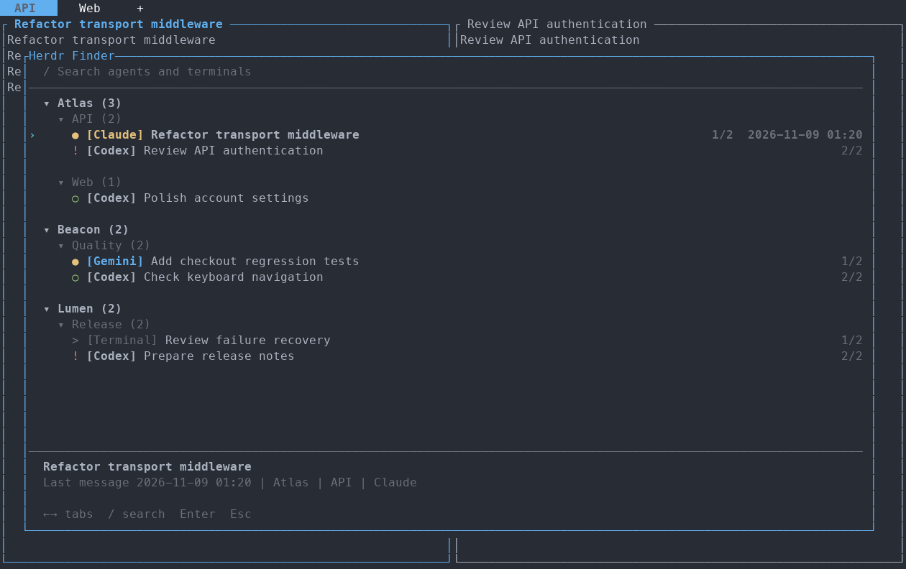
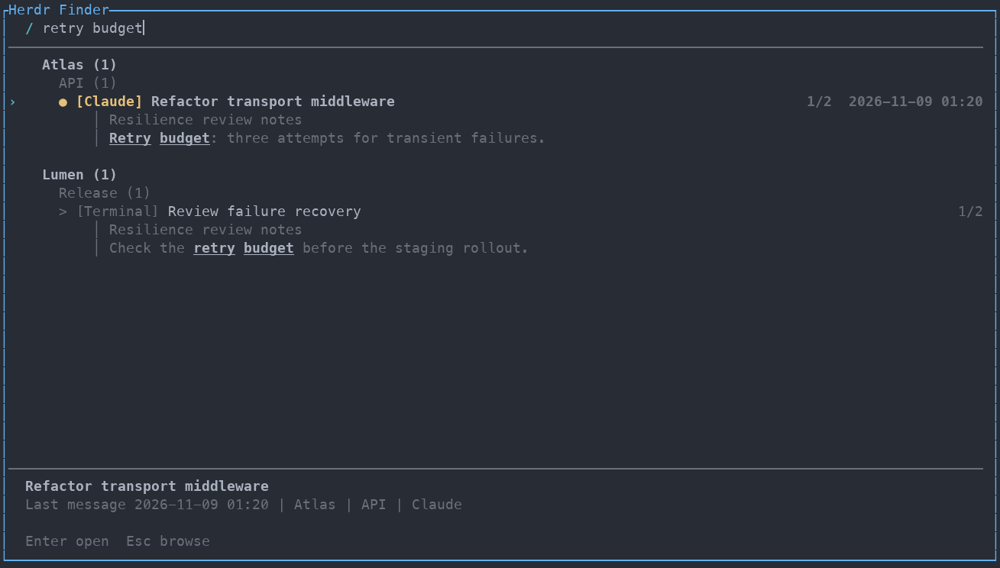

# Herdr Finder

Find the terminal that printed an error or asked a question. Browse running agents
and terminals by workspace and tab, search their visible text, and jump straight
back to the matching pane.



- **Find by output.** Search task labels, agents, paths, and the current visible
  screen. Every typed term must match; matching lines show highlighted context.
- **Keep your bearings.** Results stay in workspace → tab → pane order, with
  agent status and labels using your terminal palette.
- **Resume the session.** Enter or double-click opens its original terminal.



*Recorded from real plugin runs with demo sessions. ANSI output is rendered with
an example terminal palette; these are not desktop screenshots.*

Uses your terminal's ANSI palette for accents. OSC 10/11 color queries derive
softer text and subtle excerpt backgrounds from your terminal colors. The UI opens
before querying and keeps terminal defaults when colors aren't available.
`NO_COLOR` disables color queries and accents.

## Install

Requires Herdr 0.9.5+, `curl`, `tar`, and `sha256sum` or `shasum`.
Prebuilt binaries support Apple Silicon/Intel macOS 11+ and x64/ARM64 Linux.
Rust and a C toolchain are only needed for development.

```sh
herdr plugin install 2ykwang/herdr-finder
```

Add the shortcut to `~/.config/herdr/config.toml`:

```toml
[[keys.command]]
key = "prefix+shift+f"
type = "plugin_action"
command = "herdr-finder.open"
description = "Find a running session"
```

```sh
herdr config check
herdr server reload-config
```

Press your Herdr prefix, then **Shift+F**. With a Ctrl+A prefix, that's
**Ctrl+A, Shift+F**. Update with `herdr plugin update herdr-finder`.

## Controls

| Key | Action |
| --- | --- |
| Up / Down | Select a row |
| Left / Right | Jump between tabs; move the text cursor while searching |
| Alt+Left / Alt+Right | Jump between workspaces while browsing |
| `/` | Start searching |
| Esc | Return to browsing, then close |
| Enter | Open a session or toggle a group |
| Click / double-click | Select / open a session |
| F1 | Help |

## Develop

Install Rust and a C toolchain, then build the local checkout:

```sh
cargo test --locked
cargo fmt --check
cargo clippy --locked --all-targets -- -D warnings
sh scripts/build.sh
herdr plugin link .
```

Unlink your local checkout before switching to a GitHub-managed installation.

Marketplace discovery requires a public repository with the `herdr-plugin`
GitHub topic and `herdr-plugin.toml` on its default branch.

MIT and Apache-2.0. See [LICENSE](LICENSE) and [third-party notices](THIRD_PARTY.md).
